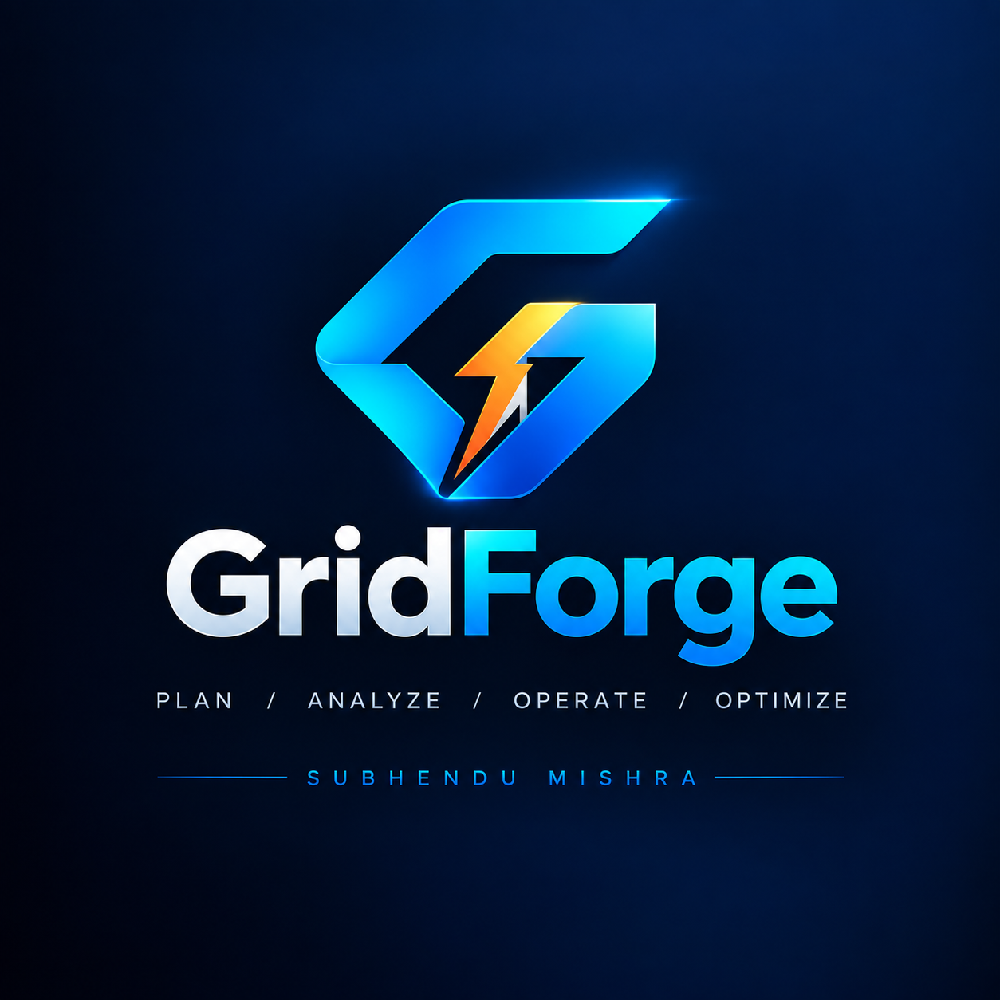
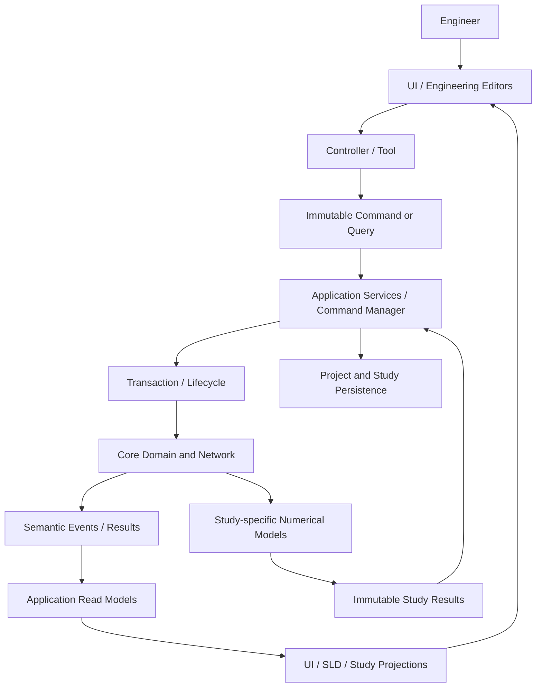

# GridForge V2

<p align="center">
  
</p>

<p align="center">
  <b>Power-System Digital Twin · Engineering · Simulation · Protection · Automation</b>
</p>

<p align="center"><i>By Engineers. For Engineers.</i></p>

<p align="center">
  
  
  
  
</p>

**Author:** Subhendu Mishra

> **Documentation baseline: 2 November 2026.** This README describes the merged `main` baseline at commit `a9e07287c90667a7aae8bcc060e4e2d0cadf261e`. Open or draft pull requests are not represented as merged capabilities. Architectural implementation status is not a claim of runtime, numerical, commissioning, or production verification.

## What is GridForge?

GridForge is a Python-based power-system engineering environment for modelling electrical assets and networks, authoring single-line diagrams, configuring protection and control, running engineering studies, simulating system behaviour, and retaining traceable project and study data.

GridForge is a digital-twin platform rather than a diagram editor with calculations attached. The electrical model, terminal relationships, topology, equipment state, validation and engineering results have explicit ownership independent of their graphical presentation.

## Architecture at a glance

**Core owns engineering truth. Application owns controlled mutation and workflow. UI owns interaction and projection.**



### Layer responsibilities

| Layer | Owns | Must not own |
|---|---|---|
| **Core** | Physical equipment, terminals, electrical quantities, network relationships, topology, domain validation, protection/control semantics, study-domain inputs and immutable engineering results | Qt, QGraphics, widgets, SLD documents, UI controllers, plugin managers |
| **Application** | Commands, handlers, services, transactions, rollback, history, project lifecycle, study orchestration, persistence coordination, semantic events and read models | A second electrical model or solver-owned topology |
| **UI** | Editors, tools, selection, canvas geometry, SLD authoring/projection, inspectors, dashboards and result visualization | Direct Core mutation or inferred electrical truth from pixels |
| **Plugins** | Domain algorithms and extension contributions through public contracts | Competing Core/Application authorities or private mutation paths |

The universal mutation/publication path is:

```text
UI / SLD → Controller → Immutable Command → Application
         → Transaction → Core → Semantic Event / Result
         → Application Read Model → UI Projection
```

A failed Application transaction must not leave a partially applied engineering mutation. Undo/redo and lifecycle compensation remain Application responsibilities.

## Electrical model, network and conductors

### Physical equipment and terminals

Equipment represents physical devices and owns its physical parameters, configuration and operational state. Its terminals identify physical electrical connection points. Equipment objects do not independently own global network topology.

### Simple Wire connectivity

The canonical Simple Wire relationship is a persistent terminal-to-terminal network relationship. Its identity and endpoint references are authoritative; SLD route geometry is presentation data only. A graphical snap or crossing does not by itself create electrical connectivity.

The connectivity schema is versioned separately from package metadata and SLD presentation. Loading restores equipment and terminals before relationships, validates the relationships, and then rebuilds derived topology. Invalid dangling relationships must fail persistence validation rather than being silently dropped.

### Phase-domain conductor graph

The phase-domain conductor graph is a **study/network representation**, distinct from the SLD's Simple Wire drawing primitive. It represents explicit physical conductor paths and phase/neutral/earth connectivity for supported studies. It must not be conflated with a Simple Wire, nor reconstructed from screen geometry.

The merged PR #908 introduced phase-domain graph/admittance/fault-execution foundations, conductor inventories and topology associations, reversible Application graph-edit commands, and persistence/migration support. The merged scope is explicitly partial: equipment/source coverage, physical switching primitives, SLD authoring/projection, and physical neutral/earth measurement coverage remain bounded by the contracts actually implemented. Unsupported cases fail closed; metadata or visual proximity is not evidence of a physical return path.

### Transformer and multiport boundary

Transformer study preparation must preserve winding identity, terminal domain, connection group, tap/sequence data, impedance bases and supported zero-sequence/phase-domain semantics. A multiport numerical representation is study-specific derived data, not a second persistent transformer model. The merged baseline supports only explicitly validated transformer sequence/terminal-domain cases; broader transformer winding, internal delta-loop, and phase-domain producer coverage must be documented as partial until individually implemented and verified.

## SLD and engineering workspaces

The Single-Line Diagram is a first-class engineering authoring and visualization workflow, but it is not the authoritative network model.

- The engineer places equipment using the palette and discipline tools.
- Placement and connection previews remain transient authoring state.
- Equipment properties and terminal relationships are explicit engineering data.
- The Application commit boundary creates authoritative equipment/network relationships.
- SLD symbols and connection routes are separate presentation representations.
- Selection, geometry, routing and editor state remain UI-owned.
- Reopen reconstructs the persisted semantic document and then projects it into runtime graphics.

The workspace composition is Blender-inspired in its organization, not in its implementation: Window → Workspace → Areas → Editors → Regions → Editor Context → Discipline Tools. SLD, Control, Protection and Study editors compose their own regions and commands. Qt access is centralized through `ui/core/qt.py`; Core remains headless.

**Important boundary:** PR #908 did not deliver the phase-domain graph's complete SLD authoring/editor workflow. Programmatic Application graph editing and persistence are not equivalent to a finished engineer-facing canvas workflow.

## Protection system and studies

Protection is a distinct engineering subsystem, not just a collection of ANSI algorithms.

### Measurement path

```text
Primary electrical network
  → CT / PT / CVT primary terminals
  → physical secondary circuit / secondary terminals
  → MeasurementChannel
  → RelayInput
  → ProtectionElement hosted by a physical Relay
```

Primary-side instrument association, secondary wiring, measurement-channel identity, units, quality, freshness and source provenance remain explicit. CT secondary measurements must not be fabricated from a relay setting or inferred from graphical placement.

### Decision and operation path

```text
ProtectionElement evaluation
  → ProtectionDecision
  → explicit Protection Scheme / output-to-action mapping
  → Application authorization and command
  → Breaker / switching service
  → authoritative equipment state and feedback
```

A ProtectionDecision is not a breaker state mutation. The physical relay may host multiple independent protection-function elements. Each function has its own input contract, settings, implementation status and result.

### Protection Study

The Application-owned Protection Study coordinates the project/network snapshot, fault scenarios, short-circuit inputs, measurement snapshots, relay evaluation, coordination diagnostics, result provenance and presentation. It reuses the canonical study service, command/transaction, event and read-model infrastructure; it must not introduce a second study scheduler, topology, measurement system, event bus or result store.

### Merged baseline and explicit limits

PR #908 is merged. It integrated detached, Application-authorized CT terminal-current samples for explicitly supported Line/Cable and transformer sequence cases; tap-aware transformer sequence preparation; typed terminal-current records; explicit residual-source bindings and derived residual-current inputs for ANSI 50N/51N where supported; transformer winding/neutral declarations; physical conductor inventories; phase-domain graph/admittance/fault-execution foundations; reversible Application graph edits; and connectivity persistence/migration.

This does **not** establish complete protection production readiness. Automatic phase-domain source equivalents are not available for every Grid/Generator/Motor/equipment family; dedicated switching, load and arc-fault primitives remain incomplete; neutral CT/CBCT execution is limited to proven physical paths and supported result coverage; full SLD graph authoring remains outstanding. GF-PROT-042 and other documented production integration obligations remain open until their exact live call paths and evidence are closed.

## Studies, solvers and results

Study-specific numerical models are derived from canonical Core/network state and explicit study configuration. A solver must not become an independent equipment or topology authority.

- **Power flow:** study configuration supplies bus operating categories and solver inputs; numerical network construction and results remain study-specific.
- **Short circuit:** sequence-domain and phase-domain methods consume supported equipment/network contracts. Unsupported source, conductor, grounding or switching cases must be reported as unsupported rather than approximated silently.
- **Dynamics:** dynamic state and transient solvers are separate from persistent static network truth. A solved operating point may initialize a dynamic study but does not replace the project model.
- **Protection coordination:** static and transient coordination evidence must preserve relay/function identity, current bases, breaker clearing-time assumptions and model limitations.
- **Study results:** immutable outcomes retain project, activation, study and source-revision provenance. Historical results are not projected as if they were the live SLD state.

## Project persistence

The canonical project package is `.gridforge`. The package manifest identifies package/schema/version metadata; `project.json` contains canonical project state and supported persisted sections.

```text
project.gridforge
├── manifest.json
└── project.json
```

The persisted state may include equipment/network data, authoritative connectivity, SLD document collection and presentation state, measurement definitions, dynamic models, protection/control configuration, and other versioned sections supported by the current schema. Runtime Qt widgets, QGraphicsItems, canvas scenes, tool instances and selection objects are never persisted as engineering truth.

Load ordering, schema migration, structural validation, project activation and compensation belong to the persistence/Application boundary. Save/load completeness must be assessed per field and service activation path; serialization alone does not prove runtime restoration.

Study-result archives are separate from the canonical project package and must preserve project/generation/source-revision provenance.

## Plugin architecture

Plugins extend GridForge through public contracts for domain algorithms, equipment/model capabilities, study handlers, integrations, tools, editors, panels, renderers and reports. They reuse existing Application services for commands, transactions, studies, events and results. A plugin must not create a parallel command manager, transaction manager, scheduler, event bus, result authority, topology or UI lifecycle manager.

CPU is the portable baseline where the algorithm supports it. GPU/NPU support is advertised only for implemented computation paths, with explicit capability detection and fallback/unsupported reporting. Device availability or an inference provider is not proof of physics-solver acceleration.

## Repository map

```text
GridForge/
├── core/                 Headless engineering model, network, domain and solvers
├── core/application/     Commands, services, transactions and orchestration
├── ui/                   Editors, controllers, tools, canvas and projections
├── plugins/              Domain and integration extensions
├── docs/architecture/    Architecture contracts and amendments
├── audit/                Audit evidence and reconciliation records
├── Modification_Register.txt
├── contract.md
└── README.md
```

## Architecture documents

| Document | Authority / subject |
|---|---|
| [Current V2 architecture and implementation boundary](docs/architecture/GRIDFORGE_V2_ARCHITECTURE_2026-11-02.md) | Consolidated cross-layer architecture and merged-main capability boundary |
| [Protection and phase-domain architecture amendment](docs/architecture/PROTECTION_PHASE_DOMAIN_ARCHITECTURE_AMENDMENT_2026-11-02.md) | PR #908 integration, conductor graph, protection measurement and explicit gaps |
| [Simple Wire connectivity schema](docs/architecture/simple_wire_connectivity_schema.md) | Persistent terminal-to-terminal relationship contract |
| [Engineering workspace architecture](docs/UI_ARCHITECTURE_BLENDER_STYLE.md) | Workspace/editor/region composition and UI ownership |
| [Plugin infrastructure reuse matrix](docs/architecture/GRIDFORGE_V2_PLUGIN_REUSE_MATRIX.md) | Reuse rules and plugin integration gaps |
| [Shared Plugin SDK architecture](docs/architecture/GRIDFORGE_V2_SHARED_PLUGIN_SDK_ARCHITECTURE.md) | Subordinate plugin SDK amendment; concrete API remains provisional |
| [Protection Study and system architecture](docs/architecture/PROTECTION_STUDY_AND_SYSTEM_ARCHITECTURE.md) | Protection domain and study contracts |
| [SLD and network contract](contract.md) | Historical working baseline; read with the current V2 architecture and later amendments |

## Architectural invariants

1. Core is the sole authoritative engineering model.
2. Core has no Qt, QGraphics, SLD or UI dependency.
3. Application is the only controlled mutation/workflow boundary.
4. Commands are explicit; mutations are transactional and reversible where supported.
5. Equipment, terminals, connections and derived topology are distinct concepts.
6. SLD geometry never establishes electrical connectivity.
7. Simple Wire relationships and phase-domain conductor graphs are distinct representations with distinct purposes.
8. Numerical models are derived study inputs, not persistent engineering truth.
9. Protection decisions and physical switching state are distinct.
10. Instrument primary association and secondary measurement wiring are explicit.
11. Unsupported or ambiguous electrical semantics fail closed; no fabricated values, paths or acknowledgements.
12. Plugins reuse existing owners and do not introduce parallel infrastructure.
13. Persistence stores canonical semantic/project state, not runtime graphics.
14. UI projections are refreshed from Application read models and semantic events.
15. Implementation status, static inspection and runtime/engineering verification are reported separately.

## Current mainline status (2 November 2026)

- **Merged:** PR #908 — Protection Study scenario snapshots, supported ANSI 50N/51N residual measurement integration, transformer sequence preparation, phase-domain conductor graph foundations, Application graph-edit commands, and persistence/migration foundations.
- **Merged:** PR #909 — draft Simple Wire preview styling; it does not alter electrical connectivity.
- **Not merged at this baseline:** PRs #912–#918 are separate open/draft workstreams. Their code must not be described as mainline functionality until reconciled and merged.
- **Known evidence boundary:** the #908 merge was based on remote source inspection/integration review; no tests or CI were run. Syntax/import integrity, persistence round-trip, numerical fixtures and end-to-end runtime execution remain unverified as recorded in that PR.
- **Coverage is bounded, not absent:** explicit phase-domain pole paths for supported Breaker/Switch/Disconnector/Fuse construction and operating states, transformer winding multiports, grounded-wye neutral/electrode/earth-return paths, and evidence-bound delta-loop MNA states are recorded in D15F-29–37. Their construction inputs, model coverage, numerical fixtures and runtime evidence remain scoped; they are not universal device support.
- **Remaining gaps:** automatic phase-domain source equivalents for all Grid/Generator/Motor models; unsupported machine/load/arc-fault and other switching primitives; broader neutral CT/CBCT construction and measurement coverage; complete UI configuration/inspection for all physical conductor construction; and end-to-end Protection Study/commissioning evidence.
- **Known lifecycle integration gap:** the prior source audit found measurement definitions serialized and returned by the loader but not visibly applied to `MeasurementChannelService` during bootstrap activation. Keep this open until the active load/activation call path is re-traced and corrected.
- **Not a production declaration:** source-level implementation, static inspection, numerical validation, runtime execution and commissioning remain separate evidence levels.


## Mutation, lifecycle and engineering workflow

All engineering mutations follow one Application-owned path:

```text
Engineer → UI / Tool → Controller → Immutable Command
         → Application handler/service → Transaction
         → Core mutation → Semantic event/read model → UI projection
```

The Application command boundary validates and resolves handlers, opens the transaction, executes the operation, commits or rolls back, and records supported history. A failed operation must not leave partial engineering state. Undo/redo belongs to Application command history, not a parallel UI history.

### Project lifecycle and restoration

`.gridforge` is the canonical project package. The lifecycle service coordinates candidate load, structural validation, project activation, save, close and compensation. Project identity and activation-generation provenance must be preserved by project-scoped services. If activation fails, compensations run in reverse order; a failed compensation is a recovery state, not a successful rollback.

Load/reopen restores canonical equipment and terminals, connectivity, derived topology, SLD document collection and supported measurement/protection/control/dynamic configuration before UI projections are rebuilt. Runtime widgets, QGraphicsItems, selections and tool instances are never persisted as engineering truth.

**Open integration finding:** the previous source audit identified a measurement-definition activation gap: definitions are serialized and returned by the loader, but the bootstrap path did not visibly apply `loaded.measurement_definitions` to `MeasurementChannelService`. This remains an open source-trace item until current activation code proves otherwise. Likewise, GF-PROT-042 remains open until the production trigger/timestamp contract and persisted typed function-to-target mapping are demonstrated.

### SLD authoring lifecycle

1. Palette/tool selection creates transient placement intent and preview.
2. Engineer configures equipment properties and explicit terminal endpoints.
3. Draft connections remain separate from committed topology.
4. Application validates and commits equipment/connectivity transactionally.
5. Canonical SLD projections are rebuilt from semantic/read-model state.
6. Save/reopen restores the document collection and projects it into runtime graphics.

A graphical crossing, snap, symbol or route never establishes electrical connectivity.

## Engineering domains

| Domain | Responsibility |
|---|---|
| Network / topology | Canonical terminal relationships, bus attachment, switching-aware derived topology |
| Power flow / short circuit | Study-specific numerical preparation and immutable results |
| Phase-domain conductors | Explicit conductor identities, impedance, physical return paths and supported fault-current execution |
| Protection | Physical relays, function elements, measurement bindings, decisions, schemes and coordination |
| Control | Logic, interlocks, permissives, timers and control I/O through defined contracts |
| Dynamics | Transient state and solver models derived from a compatible operating point |
| Plugins | Contract-bound domain algorithms, study handlers, editors, tools and reports |

## Repository working and verification policy

The repository change workflow is `FETCH → AUDIT → RECONCILE → CORRECT → CHECK → FREEZE`. Review changes against the current authoritative `main`, preserve implementation provenance, and distinguish static source inspection from runtime, numerical and commissioning evidence. Tests and CI are not acceptance gates unless explicitly requested; never imply they ran when they did not.

## Engineering change workflow

```text
FETCH → AUDIT → RECONCILE → CORRECT → CHECK → FREEZE
```

A change is accepted against the current authoritative `main`, not against a stale branch description. Check architecture boundaries, affected public exports, Qt centralization, import/syntax integrity where requested, persistence and diff hygiene. Tests and CI are not acceptance gates unless explicitly requested.

---

<p align="center"><b>One authoritative engineering truth. One controlled Application boundary. Multiple specialized engineering workflows and projections.</b></p>
